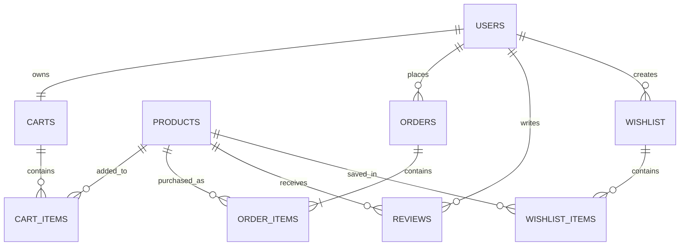

## Getting Started

First, run the development server:

```bash
npm run dev
# or
yarn dev
# or
pnpm dev
# or
bun dev
```


## Overview
Chamazon is an e-commerce web app. Allows users to shop and peruse all of our wares and wonders.

## Features
Users can:
1. Search up store products
2. Add products to carts for checkout
3. Checkout
4. Create wishlist saving products they are interested in
5. View others users wishlists if public


## Tech-stack
- Typescript
- Supabase
- Tailwind CSS
- Express.js
- Next.js
- React

## Project-Structure
### Pages
**`/app/(app)`**
> This route group is for the Store Page
**`/app/(auth)`**
> This route is the pages users interact when registering an account.

### Authentication
Supabase authentication is used for authenticating clients that visit the app. Opting for using `anonymous users` by default for users with no session.

**`/lib/actions/auth.ts`**
> Consist of server actions called for managing client session states being called in `(auth)` route pages
**`/lib/validation`**
> Schemas used to validate client form input on our server before submitting data to supabase server.
**`/app/auth/callback/route.ts`**
> Next.js route handler that handles `GET` requests to this endpoint. This is utilized by clients via clicking magic link sent to users via email after registration which is used for obtaining a session.

**`lib/supabase`**
> - `/client.ts`, `/server`: Contains the constructor for a browser client and server client instance of supabase respectively.
> - `/proxy.ts`: Breaks clients into separate groups and re-routes depending user state
>> - __Authernticated users__: These users are able to interface with all routes in the `(app)` routing group and can utilized all features within the web app.
>> - __Anonymous Users__: These Users are permitted to do most actions that __authenticated__ can however are not allowed to complete certain actions and routes noted by the `protectedRoutes` list in `proxy.ts`. For a better explanation on permitted operations by clients refer to [Database Design](#database-design)

## Database Design
Supabase changes are made via migrations within `/supabase/migrations`

### Tables


The database uses PostgreSQL via Supabase.


### Tables

| Table | Description |
|---|---|
| `users` | User profiles linked to Supabase Auth |
| `products` | Store catalog and pricing |
| `carts` | One cart per user |
| `cart_items` | Products and quantities within a cart |
| `orders` | Customer orders and checkout status |
| `order_items` | Purchased products with price snapshots |
| `reviews` | Product ratings and reviews |
| `wishlist` | User-created public/private wishlists |
| `wishlist_items` | Products saved to wishlists |


### Database Design Decisions

**Authentication and Authorization**

- Supabase Auth supports anonymous and permanently registered accounts.
- Row Level Security (RLS) restricts access to user-owned resources.
- Anonymous shoppers can manage carts and initiate guest checkout.
- Permanent accounts are required to create wishlists and submit product reviews.
- Public wishlists can be viewed by anyone, while private wishlists are accessible only to their owners.

**Cart and Checkout**

- Each user has one cart, identified by their user ID.
- Cart modifications are handled through PostgreSQL functions to coordinate concurrent operations.
- Checkout uses a transactional PostgreSQL function to validate products, create orders, snapshot product prices, and clear the cart.
- Checkout requests use idempotency keys to prevent duplicate order creation when requests are retried.

**Data Integrity**

- Foreign keys enforce relationships between users, products, orders, and wishlists.
- Composite primary keys prevent duplicate products within carts, orders, and wishlists.
- Purchased product names and prices are preserved in `order_items`, ensuring historical order records remain consistent when catalog data changes.

## API Documentation
> This is tk later when express api is implemented.
